# ⚡ GridWatch — Transmission Grid Monitoring & Alert System

**A Python-based interactive dashboard for monitoring a simulated high-voltage transmission network, detecting operating abnormalities, managing alarms, and analyzing historical system performance.**

[](https://gridwatch-transmission.streamlit.app/)
[](https://www.python.org/)
[](https://streamlit.io/)
[](https://www.sqlite.org/)

**[Live Application](https://gridwatch-transmission.streamlit.app/) | [GitHub Repository](https://github.com/AhmadMehmood4/gridwatch) | [Portfolio](https://ahmadmehmood.dev)**

---

## 1. Project Overview

GridWatch is a transmission grid monitoring and alert system developed using Python, Streamlit, and SQLite.

The project demonstrates how a centralized monitoring application can help operators observe transmission network conditions, identify equipment abnormalities, respond to alarms, and review historical operating data.

The application uses synthetic telemetry from a fictional Ontario-inspired transmission network. It provides an interactive environment for testing overloads, voltage abnormalities, equipment outages, and recovery scenarios.

The simulated network consists of:

- **8 substations**
- **12 transmission lines**
- **500 kV, 230 kV, and 115 kV voltage classes**
- **Automated overload, outage, and voltage monitoring**
- **Operator alarm acknowledgement**
- **Persistent alarm and operational event history**
- **SQL-based historical analytics and reports**

### Operations Overview

The Operations Overview dashboard provides a real-time summary of simulated network conditions.

It displays equipment availability, transmission-line loading, active warnings, critical alarms, and operational events.

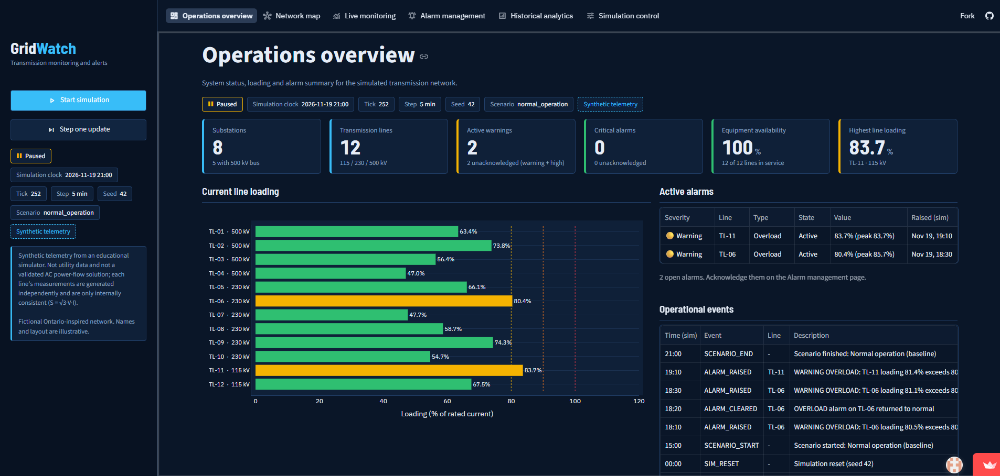

### Transmission Network Map

GridWatch includes an interactive schematic single-line network map showing the connections between substations.

Users can select individual transmission lines to view:

- Current loading (%)
- Measured voltage (kV and pu)
- Current (A)
- Active power (MW)
- Reactive power (MVAr)
- Apparent power (MVA)
- Equipment operating status
- Associated alarms and historical loading trends

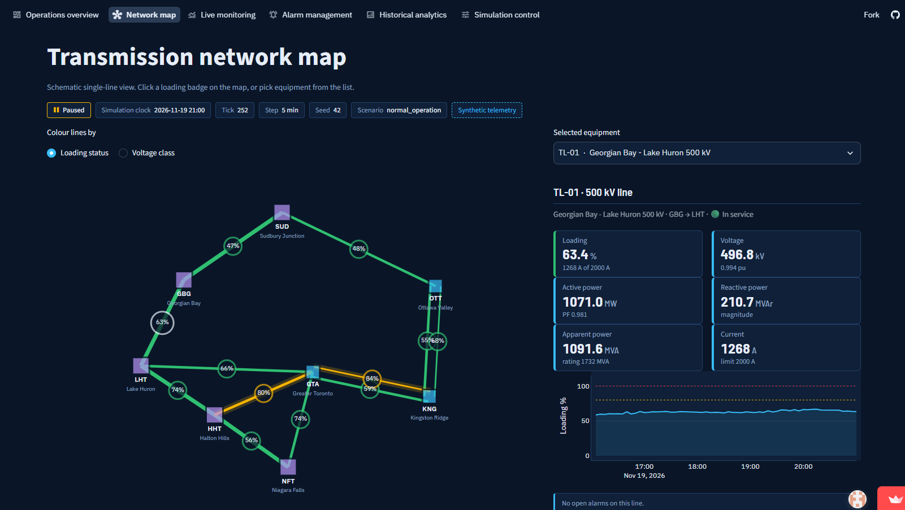

---

## 2. Key Features

### Real-Time Transmission Monitoring

GridWatch continuously displays simulated electrical measurements for the transmission network.

The dashboard updates as the simulation advances, allowing users to observe changing loading conditions and equipment performance.

### Automated Alarm Detection

The system monitors predefined operating thresholds and creates alarms when abnormal conditions occur.

Supported alarm conditions include:

- Transmission-line overloads
- Undervoltage conditions
- Equipment outages

Overload alarms are classified into Warning, High, and Critical severity levels.

### Alarm Acknowledgement and Management

Operators can acknowledge alarms without automatically clearing the underlying equipment fault.

The application records acknowledgement status, severity, alarm history, and recovery information.

### Fault Injection and Recovery

GridWatch allows users to simulate abnormal operating conditions, including:

- Increasing transmission-line loading
- Taking a transmission line out of service
- Restoring equipment to normal operation
- Introducing voltage abnormalities
- Restoring voltage to acceptable levels

### Historical Analytics

Simulated telemetry and alarms are stored in a SQLite database.

SQL queries are used to analyze loading trends, equipment utilization, voltage deviations, alarm frequency, and operational history.

---

## 3. System Validation and Testing

GridWatch was evaluated through seven functional tests to verify its monitoring, fault detection, alarm management, and historical analytics capabilities.

All tests used synthetic telemetry generated by the simulation.

### Test 1 — Normal Operating Conditions

**Objective:** Verify that GridWatch displays the simulated transmission network and its operating measurements correctly.

The initial dashboard displayed:

- 8 substations
- 12 transmission lines
- Equipment availability and loading percentages
- Active alarm counts
- Operational event records

The interactive network map also displayed transmission-line loading, voltage, current, and power measurements.

**Result:** The dashboard and network map successfully displayed the simulated network and operating data.


### Test 2 — Transmission Line Overload Detection

**Objective:** Verify that GridWatch detects increasing transmission-line loading and assigns the correct alarm severity.

The test was performed on:

**TL-01 — Georgian Bay to Lake Huron (500 kV)**

Rated-current limit: **2,000 A**

Three loading conditions were simulated.

| Test Stage | Target Loading | Actual Loading | Alarm Severity |
|---|---:|---:|---|
| Warning | 85% | 85.6% | Warning |
| High | 95% | 95.6% | High |
| Critical | 105% | 103.9% | Critical |

#### Stage 1 — Warning

Loading was increased to approximately 85%.

GridWatch detected actual loading of 85.6% and generated a Warning alarm because the line exceeded the 80% threshold.

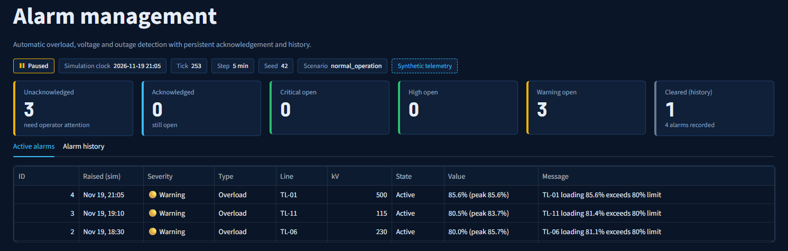

#### Stage 2 — High

Loading was increased to approximately 95%.

The existing TL-01 alarm escalated to High severity when loading reached 95.6%.

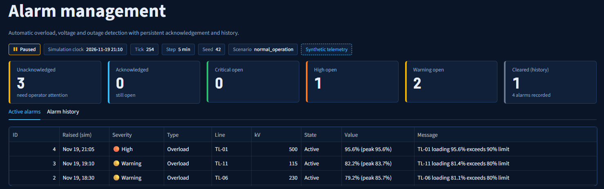

#### Stage 3 — Critical

Loading was increased beyond the line's rated-current limit.

GridWatch reported:

- **Actual loading:** 103.9%
- **Current:** 2,078 A
- **Rated-current limit:** 2,000 A
- **Alarm severity:** Critical

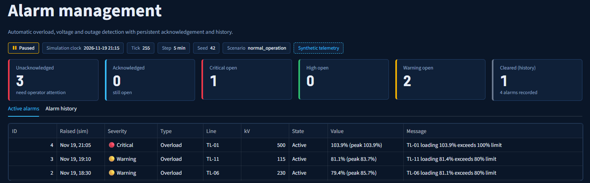

The network map highlighted TL-01 in red to indicate the critical overload condition.


**Result:** GridWatch successfully identified all three overload severity levels and escalated the existing alarm as loading increased.

### Test 3 — Alarm Acknowledgement and Persistence

**Objective:** Verify that an operator can acknowledge an active alarm while the underlying fault remains unresolved.

The Critical overload alarm from Test 2 was acknowledged.

After acknowledgement:

- The unacknowledged alarm count decreased from 3 to 2.
- The acknowledged alarm count increased from 0 to 1.
- TL-01 remained in Critical condition.
- The alarm remained visible in the active alarm list.
- The network map continued showing TL-01 in red.
- The acknowledgement was retained in alarm history.

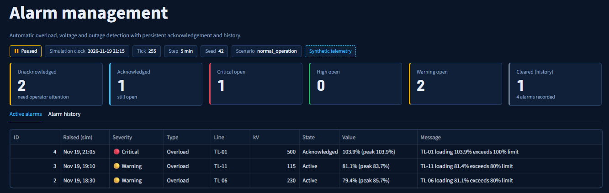

The network map confirmed that acknowledging the alarm did not change the equipment's electrical condition.

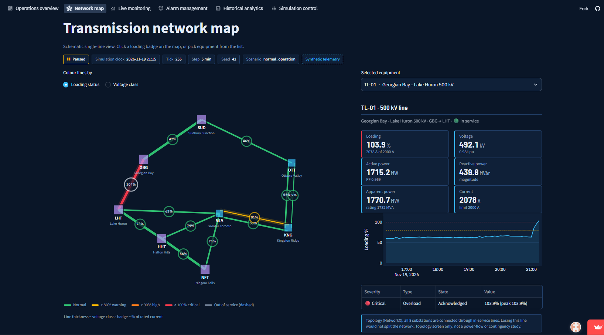

Alarm history also retained the acknowledgement information.

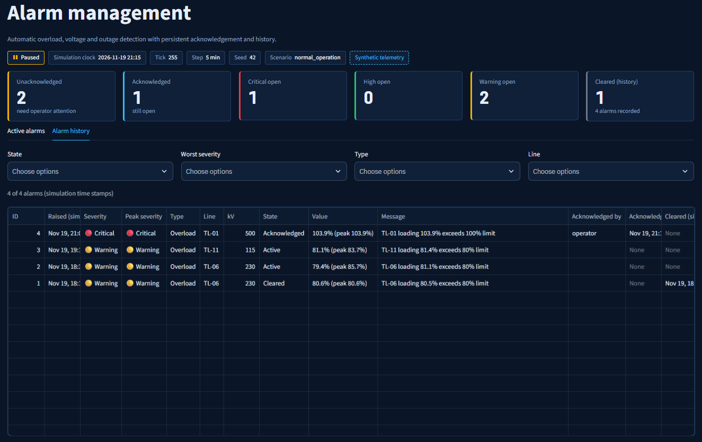

**Result:** GridWatch successfully separated operator acknowledgement from fault resolution and preserved the acknowledgement record.

### Test 4 — Fault Recovery and Alarm Clearing

**Objective:** Verify that GridWatch clears an overload alarm after the equipment returns to normal operating conditions.

The TL-01 loading was reduced to approximately 60%.

The system automatically:

- Cleared the Critical overload alarm.
- Reduced the Critical open alarm count from 1 to 0.
- Removed TL-01 from the active alarm list.
- Returned the line to its normal green visualization.
- Preserved the alarm's previous Critical severity in history.

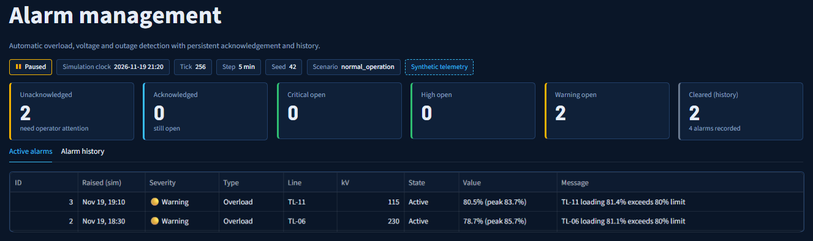

The network map showed TL-01 operating normally at 59.5% loading.

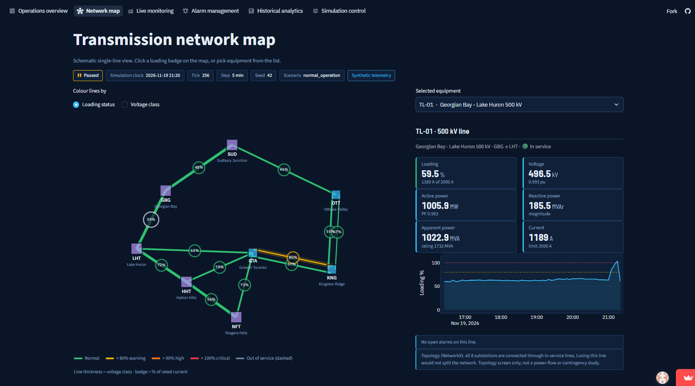

The alarm history retained the cleared overload event, including its previous Critical condition.

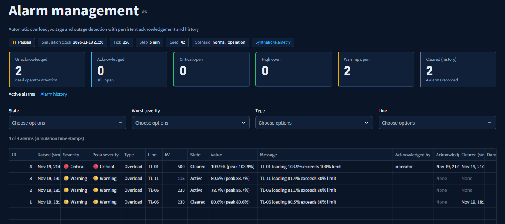

**Result:** GridWatch successfully detected equipment recovery, cleared the active alarm, and preserved the historical record.

### Test 5 — Transmission Line Outage and Network Topology

**Objective:** Verify that GridWatch detects an equipment outage and updates the network visualization.

A simulated outage was applied to TL-01.

The system generated a Critical outage alarm.

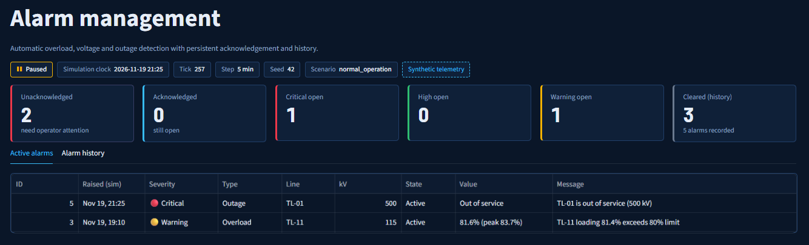

During the outage:

- TL-01 was marked Out of Service.
- Loading decreased to 0%.
- Current decreased to 0 A.
- Active and reactive power decreased to zero.
- The line appeared as a grey dashed connection.
- A Critical outage alarm was displayed.

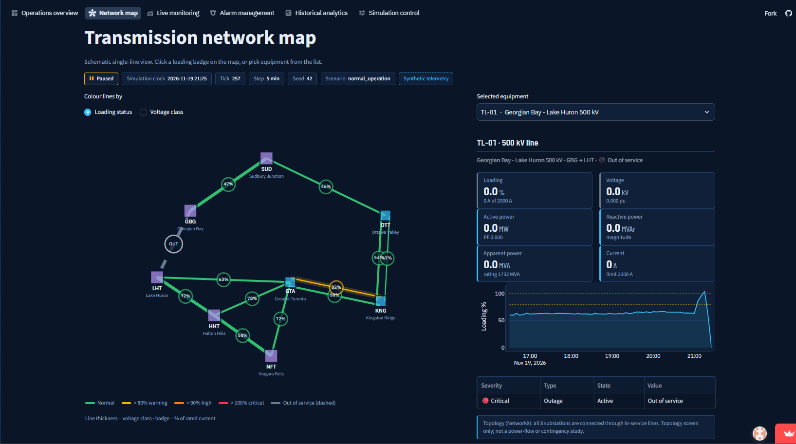

#### Equipment Restoration

TL-01 was subsequently restored to service.

Following restoration:

- Loading returned to approximately 60.1%.
- Current returned to 1,202 A.
- The line returned to its normal in-service appearance.
- The Critical outage alarm was automatically cleared.

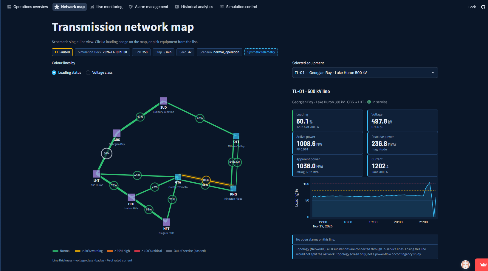

The outage and restoration records remained available in alarm history.

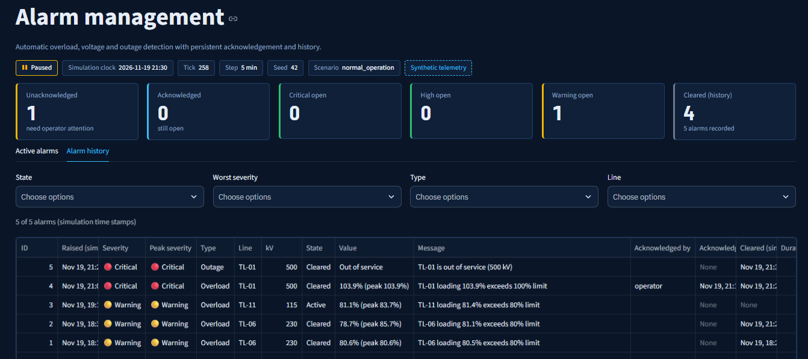

**Result:** GridWatch successfully detected the outage, updated equipment status and visualization, and recorded the recovery.

**Note:** The network map represents electrical connections and equipment status. It does not perform contingency power-flow analysis or automatic power redistribution.

### Test 6 — Voltage Abnormality Detection

**Objective:** Verify that GridWatch detects undervoltage conditions and records recovery.

A voltage abnormality was simulated on TL-01.

The target voltage was 0.90 pu on a 500 kV transmission line.

The system recorded:

- **Measured voltage:** 451.4 kV
- **Per-unit voltage:** 0.903 pu
- **Configured alarm threshold:** 0.920 pu
- **Alarm severity:** High

GridWatch generated an undervoltage alarm when the voltage fell below the configured threshold.

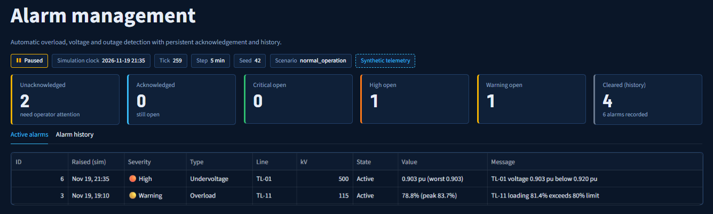

The abnormal voltage was displayed in the selected equipment measurements on the network map.

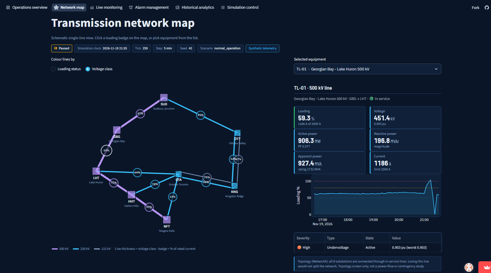

#### Voltage Recovery

The voltage was restored to approximately 1.00 pu.

Following restoration:

- Measured voltage returned to 499.7 kV.
- The undervoltage alarm automatically cleared.
- TL-01 remained in service.
- The historical alarm record was retained.

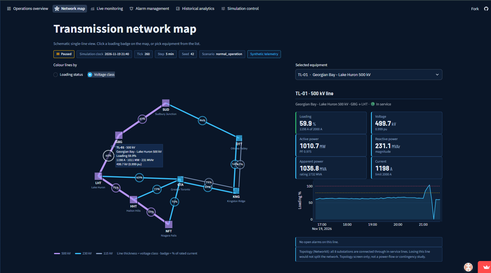

The alarm history preserved the undervoltage event and its previous High severity.

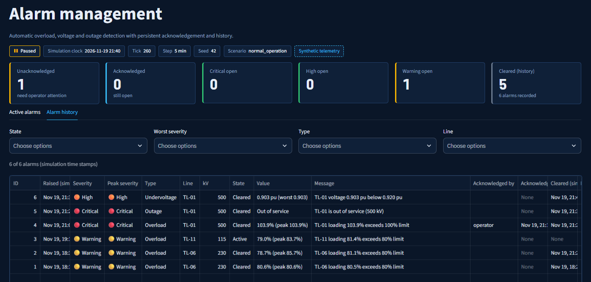

**Result:** GridWatch successfully detected an abnormal voltage condition, displayed the affected measurement, and cleared the alarm after recovery.

### Test 7 — Historical Analytics and Data Persistence

**Objective:** Verify that GridWatch stores simulated measurements and alarm records and uses SQL queries to generate historical performance reports.

The Historical Analytics dashboard was reviewed after completing the previous tests.

The final recorded statistics included:

| Metric | Recorded Result |
|---|---:|
| Telemetry samples analyzed | 3,120 |
| Total alarms raised | 6 |
| Peak transmission-line loading | 103.9% |
| Average fleet loading | 52.0% |
| Lines exceeding 90% loading | 1 |
| TL-01 equipment availability | 99.6% |
| TL-01 intervals above 90% | 2 |

#### Historical Loading Overview

The historical loading heatmap displays peak line loading across the simulated operating period.

The visualization showed the critical overload recorded on TL-01.

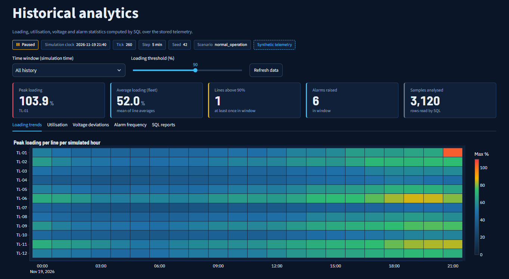

#### Average vs. Peak Loading

GridWatch compares average and maximum transmission-line loading across all 12 lines.

The chart confirmed TL-01 reached a peak loading of 103.9%.

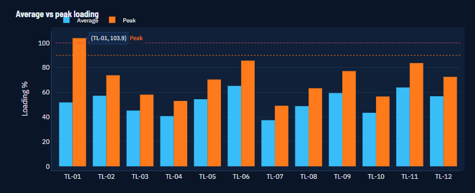

#### Equipment Utilization

The utilization report compares equipment apparent power with rated thermal capacity.

The data can be used to identify which transmission lines operate closest to their rated limits.

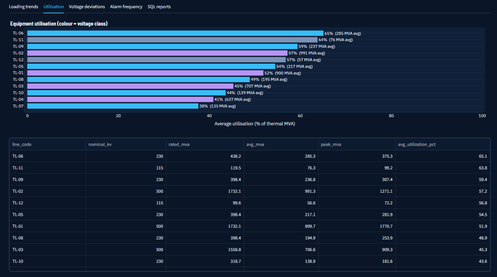

#### Voltage Deviations

The voltage analysis displays minimum, maximum, and average voltage values across the transmission network.

The report successfully retained the TL-01 undervoltage measurement:

- Voltage: 451.4 kV
- Per-unit voltage: approximately 0.903 pu
- Condition: UNDERVOLTAGE

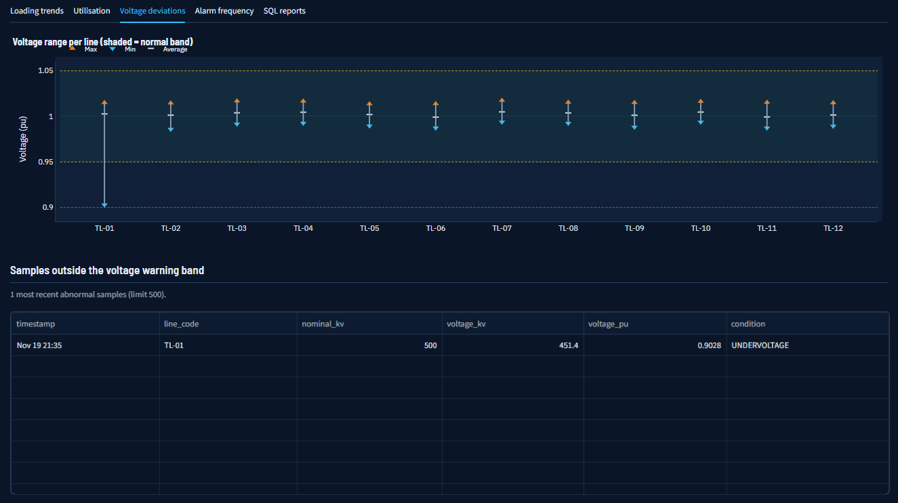

#### Alarm Frequency Analysis

The Alarm Frequency dashboard summarizes alarms by type, severity, equipment, and simulated time.

The historical records contained:

- 4 overload alarms
- 1 outage alarm
- 1 undervoltage alarm

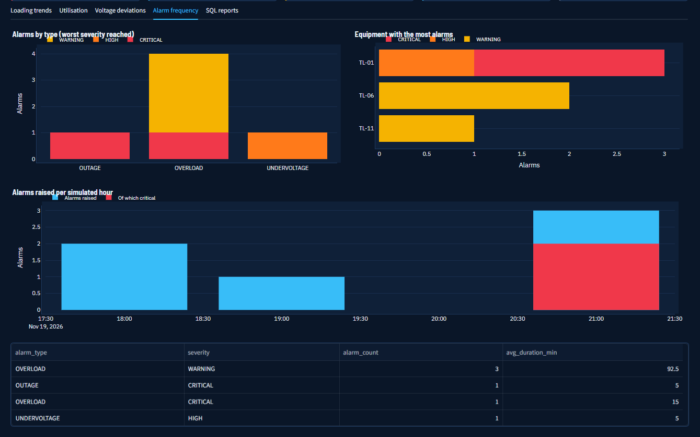

#### SQL Reports

GridWatch provides parameterized SQL reports executed against its SQLite database through SQLAlchemy.

The SQL Reports section displays the query and its results, allowing users to inspect stored measurements and equipment information.

The application also provides CSV export functionality for report results.

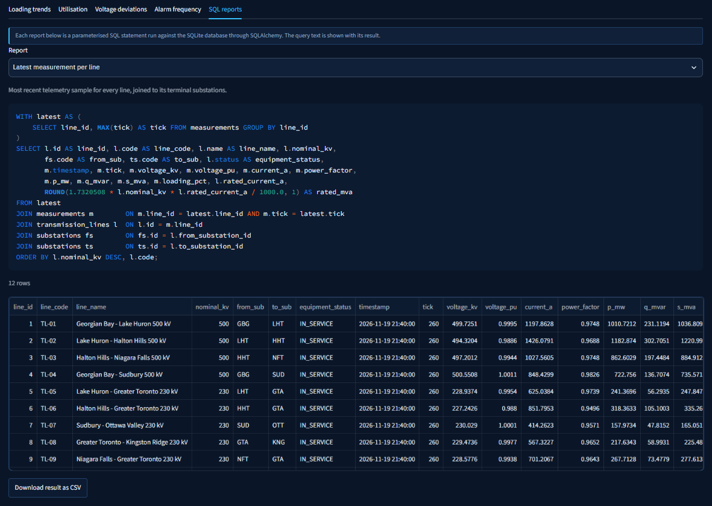

**Result:** GridWatch successfully retained historical telemetry, calculated equipment performance statistics, displayed abnormal operating events, and generated SQL reports.

---

## 4. Validation Summary

The seven functional tests demonstrated the main monitoring and alarm-management features of GridWatch.

| Test | Description | Status |
|---|---|---|
| 1 | Normal Operating Conditions | Passed |
| 2 | Transmission Line Overload Detection | Passed |
| 3 | Alarm Acknowledgement and Persistence | Passed |
| 4 | Fault Recovery and Alarm Clearing | Passed |
| 5 | Transmission Line Outage and Restoration | Passed |
| 6 | Voltage Abnormality Detection | Passed |
| 7 | Historical Analytics and SQL Reporting | Passed for demonstrated functionality |

### Main Outcomes

The testing demonstrated that GridWatch can:

1. Monitor simulated transmission equipment measurements.
2. Detect overloads and classify alarm severity.
3. Escalate an existing alarm as conditions worsen.
4. Allow operator acknowledgement without clearing unresolved faults.
5. Detect fault recovery and clear active alarms.
6. Identify transmission-line outages and update equipment status.
7. Detect undervoltage conditions and record recovery.
8. Store historical telemetry and alarm data.
9. Generate SQL-based performance reports.

---

## 5. Technologies Used

| Technology | Application |
|---|---|
| Python | Simulation logic, monitoring, calculations, and backend development |
| Streamlit | Interactive web interface and dashboard |
| SQLite | Storage of telemetry, alarms, and operational records |
| SQL | Historical data retrieval and analysis |
| SQLAlchemy | Database access and parameterized queries |
| Git | Source code version control |
| GitHub | Repository hosting |
| Streamlit Community Cloud | Public application deployment |

---

## 6. Repository Structure

```text
gridwatch/
├── .streamlit/
├── data/
├── gridwatch/
│   ├── __init__.py
│   ├── alarms.py
│   ├── analytics.py
│   ├── calculations.py
│   ├── config.py
│   ├── database.py
│   ├── events.py
│   ├── network.py
│   ├── simulator.py
│   ├── telemetry.py
│   └── ui/
├── tests/
├── app.py
├── requirements.txt
├── Launch_GridWatch.bat
├── README.md
├── 01_baseline_overview.png
├── 02_baseline_network.png
├── 03_overload_normal_warning.png
├── 04_overload_high_warning.png
├── 05_overload_critical_warning.png
├── 06_overload_network.png
├── 07_alarm_acknowledged.png
├── 08_acknowledged_network.png
├── 09_alarm_history.png
├── 10_alarm_cleared.png
├── 11_recovered_network.png
├── 12_recovery_history.png
├── 13_outage_alarm.png
├── 14_outage_network.png
├── 15_outage_recovered.png
├── 16_outage_history.png
├── 17_voltage_alarm.png
├── 18_voltage_network.png
├── 19_voltage_recovered.png
├── 20_voltage_history.png
├── 21_historical_overview.png
├── 22_historical_loading.png
├── 23_historical_utilization.png
├── 24_historical_voltage.png
├── 25_alarm_frequency.png
└── 26_sql_reports.png
```

---

## 7. Installation and Setup

### Step 1 — Clone the Repository

```bash
git clone https://github.com/AhmadMehmood4/gridwatch.git
cd gridwatch
```

### Step 2 — Create a Virtual Environment

```bash
python -m venv .venv
```

Activate the environment on Windows:

```powershell
.venv\Scripts\activate
```

For macOS or Linux:

```bash
source .venv/bin/activate
```

### Step 3 — Install Dependencies

```bash
pip install -r requirements.txt
```

### Step 4 — Run GridWatch

```bash
streamlit run app.py
```

The Streamlit dashboard will open in your browser.

Windows users can also use the included `Launch_GridWatch.bat` file to launch the application.

### Live Application

**[Launch GridWatch](https://gridwatch-transmission.streamlit.app/)**

---

## 8. Project Scope and Limitations

GridWatch is an educational engineering project designed to demonstrate transmission monitoring, alarm management, data visualization, and historical analytics.

The following limitations apply:

- The transmission network is fictional and inspired by Ontario geography.
- All telemetry is synthetically generated.
- The application is not connected to live electrical equipment, SCADA systems, or an operational EMS.
- Electrical quantities use simplified modelling and are not the result of a validated AC power-flow calculation.
- The network map illustrates equipment connectivity rather than calculating power redistribution after outages.
- Fault injection is used for controlled functional testing.
- GridWatch is not intended for actual utility operations or protection-system control.

---

## 9. What I Learned

Developing GridWatch provided practical experience in both electrical engineering and software development.

### Transmission System Monitoring

I gained experience working with voltage classes, current ratings, line loading, equipment status, and abnormal operating conditions.

### Python Development

I developed a modular Python application with separate components for simulation, telemetry, alarm processing, calculations, and analytics.

### SQL and Database Management

I worked with structured telemetry records, database queries, historical measurements, and equipment performance reports.

### Alarm Management

I implemented and tested threshold detection, severity escalation, operator acknowledgement, automatic alarm clearing, and historical tracking.

### Data Visualization

I created interactive dashboards, network diagrams, charts, loading trends, and historical reports to make operating information easier to interpret.

### Testing and Deployment

I performed controlled functional tests, documented their results, and deployed the project using GitHub and Streamlit Community Cloud.

---

## 10. Future Improvements

Potential improvements to GridWatch include:

- Integration with sample SCADA-style telemetry
- More advanced network topology analysis
- Power-flow modelling using established electrical engineering libraries
- Expanded equipment fault scenarios
- Automated event and performance reports
- Additional SQL analytics
- Expanded automated unit and integration testing
- Improved operational monitoring visualizations

---

## 11. Author

**Ahmad Mehmood**

Electrical Engineering  
Toronto Metropolitan University

**GitHub:** [AhmadMehmood4](https://github.com/AhmadMehmood4)

**Live Project:** [GridWatch Dashboard](https://gridwatch-transmission.streamlit.app/)

---

*GridWatch is a personal engineering portfolio project developed for educational and technical demonstration purposes.*
